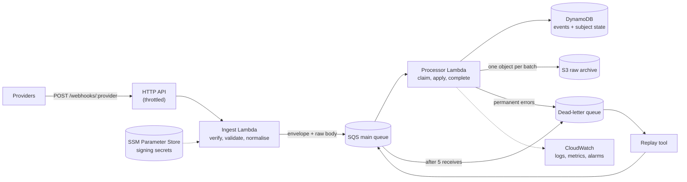

# Webhook gateway: design note
 
**Status:** Draft v0.1 · **Last updated:** November 2026
 
## 1. Summary
 
A small AWS service that receives webhooks from several providers and checks that each request really came from that provider. It turns three different payload formats into one event shape and processes each event once in effect, even though providers deliver at least once, retry and send events out of order. Raw payloads are archived, failures are parked in a dead-letter queue (DLQ) where they can be replayed, and the whole stack deploys and tears down with one command each.
 
This is a portfolio project. It puts clear guarantees, test coverage and a near-zero AWS bill ahead of scale.
 
## 2. Goals and non-goals
 
**Goals**
 
- Reject unauthenticated requests before parsing, storing or queuing anything.
- Validate and normalise every accepted payload into one versioned envelope.
- Acknowledge quickly (202) and do the real work asynchronously.
- Process each event once in effect: at-least-once delivery plus an idempotent write.
- Never lose a verified event: retries, a DLQ, a replay tool and a raw archive.
- Make failures, latency and cost visible through structured logs, metrics and alarms.
- Deploy and destroy reproducibly from a clean clone.
- Keep the AWS bill at pennies.
**Non-goals for v1**
 
- Machine learning of any kind.
- Fanning events out to subscribers (outbound webhooks).
- Multiple tenants or per-customer secrets.
- Strict global ordering. Newest-wins per subject is enough.
- A UI, a read API or a production SLA.
## 3. Providers
 
Three providers, chosen because their signing schemes differ. Payloads in tests and load tests are synthetic.
 
| Provider (slug) | Signature header | What is signed | Encoding | Replay protection | Idempotency key from |
|---|---|---|---|---|---|
| GitHub-style (`github`) | `X-Hub-Signature-256: sha256=<sig>` | raw body | hex | none; idempotency catches duplicates | `X-GitHub-Delivery` header, which stays the same across redeliveries |
| Shopify-style (`shopify`) | `X-Shopify-Hmac-Sha256: <sig>` | raw body | base64 | none; idempotency catches duplicates | `X-Shopify-Webhook-Id` header, one per delivery |
| Stripe-style (`stripe`) | `Stripe-Signature: t=<ts>,v1=<sig>` | `<ts>.<raw body>` | hex | reject if `t` is more than 5 minutes from now | event `id` in the body |
 
All three use HMAC-SHA256 with a shared secret per provider. The event type comes from `X-GitHub-Event` plus the body's `action`, from `X-Shopify-Topic`, and from the body's `type` respectively.
 
Adding a provider means one module (verifier, models, normaliser) and one registry entry. Nothing else changes.
 
## 4. Architecture
 

 
**Request path**
 
1. The HTTP API applies stage throttling and passes `POST /webhooks/{provider}` to the ingest function.
2. Ingest looks up the provider and checks the body size. It verifies the signature over the raw bytes, then parses and validates the JSON and builds the envelope.
3. Ingest sends one SQS message: the envelope, the base64 raw body and an allowlist of provider headers. It then returns 202 with the `event_id`.
4. The processor receives batches of up to 10. It archives the batch to S3 as one JSON Lines object. Then, for each record, it claims the idempotency key, applies the event and marks it complete.
5. Transient failures go back to the queue through partial batch responses, and SQS moves a message to the DLQ after 5 receives. Permanent failures go to the DLQ straight away with the error attached.
6. The replay tool moves selected DLQ messages back to the main queue. Because processing is idempotent, replaying the same message twice is harmless.
## 5. Response table
 
Ingest runs these checks in table order, and the first failure decides the response. The signature is checked before the body is parsed.
 
| Status | When | Body |
|---|---|---|
| 404 | Unknown provider in the path | `{"error": "unknown_provider"}` |
| 413 | Body larger than 128 KB | `{"error": "too_large"}` |
| 401 | Signature missing or wrong, or timestamp outside tolerance | `{"error": "unauthorized"}`, with no detail |
| 400 | Signature valid, but the body is not JSON | `{"error": "malformed_json"}` |
| 422 | Valid JSON that fails the provider's schema | `{"error": "schema_invalid", "field": "<path>"}` |
| 202 | Verified, valid and queued. Unsupported event types are also queued, marked `unhandled`, so providers don't retry them | `{"event_id": "<uuid>"}` |
| 503 | SQS still unavailable after retries | `{"error": "try_again"}` |
 
Only the gateway's own failures return 5xx. A provider's retry can then succeed, whereas a 4xx means a retry would fail the same way.
 
The 128 KB limit keeps the base64 raw body plus the envelope well under the SQS message size limit. It also means oversized bodies are rejected before any hashing.
 
## 6. Normalised envelope (v1)
 
| Field | Type | Notes |
|---|---|---|
| `schema_version` | int | `1`; bumped on breaking changes |
| `event_id` | UUID | generated by the gateway at ingest |
| `idempotency_key` | string | `<provider>:<provider_event_id>` |
| `provider` | string | `github`, `shopify` or `stripe` |
| `provider_event_id` | string | from the source given in section 3 |
| `event_type` | string | gateway vocabulary below; `unhandled` for unsupported types |
| `subject_id` | string | what the event is about, prefixed by provider, e.g. `stripe:pi_123` |
| `occurred_at` | UTC datetime | when it happened, from the payload; falls back to `received_at` when a payload has no event time |
| `received_at` | UTC datetime | when ingest accepted the request |
| `correlation_id` | string | API Gateway request ID, carried through every log line |
| `data` | object | the normalised fields for this event type |
 
**Initial event types**
 
| Provider | Source event | `event_type` | Subject |
|---|---|---|---|
| github | `push` | `code.pushed` | repository |
| github | `pull_request` closed with `merged: true` | `pull_request.merged` | pull request |
| shopify | `orders/create` | `order.created` | order |
| shopify | `orders/paid` | `order.paid` | order |
| stripe | `payment_intent.succeeded` | `payment.succeeded` | payment intent |
| stripe | `payment_intent.payment_failed` | `payment.failed` | payment intent |
| stripe | `charge.refunded` | `payment.refunded` | payment intent |
 
The JSON Schema lives in `schemas/envelope.v1.json`, and a test keeps it in step with the Pydantic model.
 
## 7. Idempotency and ordering
 
Every hop is at-least-once. Providers retry, SQS can deliver a message more than once, and Lambda retries failed batches. Rather than trying to prevent duplicates, the gateway makes processing idempotent.
 
**Claim.** Before applying an event, the processor writes `EVENT#<idempotency_key>` with a conditional put (`attribute_not_exists(pk)`), status `PROCESSING` and a `lock_expires_at` 60 seconds out. If the put fails, the existing item decides what happens:
 
| Existing item | Meaning | Action |
|---|---|---|
| `COMPLETED` | duplicate delivery | acknowledge and skip |
| `PROCESSING`, lock not expired | another invocation is working on it | return it as a batch item failure, to retry later |
| `PROCESSING`, lock expired | the earlier attempt crashed | take over with a conditional update on `lock_expires_at` |
 
After applying, the processor marks the item `COMPLETED` with an `expires_at` 7 days out (DynamoDB TTL). Seven days is longer than the longest automatic retry window among the providers: Stripe retries for up to three days. A manual redelivery after that would be processed again, which is safe because of the ordering rule below.
 
**Ordering.** Apply updates `SUBJECT#<subject_id>` only when the event is newer, using the condition `attribute_not_exists(last_occurred_at) OR last_occurred_at < :occurred_at`. A late, older delivery is recorded with outcome `stale` and leaves the state alone. Ties keep the existing state.
 
Because applying is itself safe to repeat, a crash between apply and complete does no harm.
 
## 8. Data model
 
One DynamoDB table per stage with on-demand billing. The partition key is `pk` (string), with no sort key and no indexes.
 
| Item | `pk` | Main attributes | TTL |
|---|---|---|---|
| Event record | `EVENT#<idempotency_key>` | `status`, `lock_expires_at`, `event_id`, `event_type`, `subject_id`, `occurred_at`, `processed_at`, `outcome` (`applied`, `stale`, `unhandled`) | `expires_at`, 7 days |
| Subject state | `SUBJECT#<subject_id>` | `state` (e.g. `paid`, `refunded`), `last_event_type`, `last_occurred_at`, `last_event_id`, `updated_at` | none |
 
Every access is by key, so nothing ever scans the table.
 
**Raw archive:** `raw/provider=
/dt=<YYYY-MM-DD>/hour=<HH>/<batch-id>.jsonl`, with one line per message holding the envelope, the raw body and the header allowlist. Objects expire after 30 days. A retried batch may be archived twice; each line carries its idempotency key, so duplicates are easy to drop.
 
## 9. Retries and limits (starting values)
 
| Setting | Value | Why |
|---|---|---|
| Ingest timeout and memory | 5 s, 256 MB | it only verifies and enqueues |
| Processor timeout and memory | 30 s, 256 MB | a batch is at most 10 messages of key-based writes |
| Batch size and batching window | 10, 0 s | the load test measures 1–2 s windows |
| Queue visibility timeout | 180 s | at least six times the processor timeout |
| `maxReceiveCount` | 5 | a message that keeps failing reaches the DLQ after about 15 minutes |
| DLQ retention | 14 days | time to notice, fix and replay |
| Claim lock | 60 s | longer than the processor timeout |
| boto3 retries | standard mode, 3 attempts | no hand-written sleep loops |
| Ingest concurrency | reserved, 10 | caps spend; raised with the throttle for the load test |
| Processor concurrency | `MaximumConcurrency` 5 on the event source, reserved 5 | caps spend without throttling the SQS pollers |
| API throttling | 20 requests/s, burst 40 | raised only for the load test |
 
## 10. Security
 
- Signatures are checked with HMAC over the raw bytes, using `hmac.compare_digest`, before any parsing. Headers are read case-insensitively, and base64-encoded bodies are decoded first.
- Each provider has a list of secrets, so a new secret can be added before the old one is removed.
- Secrets live in SSM Parameter Store as SecureStrings at `/webhook-gateway/<stage>/<provider>` and are cached in memory for 5 minutes. Only the ingest function can read them, and only under that path.
- Unauthenticated requests are never stored or queued, and 401 responses carry no detail.
- Floods are capped by API throttling and reserved concurrency.
- Logs never contain signatures, secrets, raw bodies or full header sets.
- Each function has its own least-privilege IAM role. CI deploys through GitHub OIDC, so the repo holds no AWS keys.
- The public repo and its Actions logs never contain the endpoint URL, the AWS account ID or email addresses.
## 11. Observability
 
- **Logs:** JSON lines through Powertools Logger, with `service`, `stage`, `provider`, `correlation_id` and `event_id`. Each function writes one summary line per event, and logs are kept for 7 days.
- **Metrics:** EMF metrics, with at most 10 metric and dimension combinations in total: `Accepted`, `Rejected` by reason, `Duplicates`, `DeadLettered` and `EndToEndLatency` (`processed_at` minus `received_at`).
- **Alarms** go to an SNS email topic: DLQ depth above 0, processor errors, ingest 5xx responses, Lambda throttles and the age of the oldest message.
- **Dashboard:** one CloudWatch dashboard showing requests, error rates, p95 duration, queue depth and DLQ depth.
## 12. Cost
 
**Targets:** about £0 for an idle month, and under £1 for a 100k-event load test. Numbers measured in the load test replace these estimates.
 
| Guardrail | Why |
|---|---|
| HTTP API, not REST API | cheaper per request |
| No VPC and no NAT gateway | a NAT gateway alone costs more per month than everything else here |
| arm64 functions | cheaper per GB-second than x86 |
| Reserved concurrency, and `MaximumConcurrency` on the processor | caps runaway spend |
| API throttling | caps request charges from a flood |
| DynamoDB on-demand | pay per request, nothing when idle |
| 7-day log retention and one summary line per event | log ingestion and storage are an easy cost to miss |
| S3 lifecycle rule (30-day expiry) and batched archive writes | about a tenth of the PUT requests |
| SSM Parameter Store, not Secrets Manager | standard parameters are free; Secrets Manager charges per secret per month |
| SSE-S3 and SSE-SQS, with no customer-managed KMS keys | KMS keys have a monthly charge |
| At most 10 custom metrics, and alarms within the free tier | both are billed per item |
| AWS Budget alert | early warning if anything slips |
| Guardrail tests in CI | stop a later change from quietly removing any of the above |
| `make destroy` with a leftover-resource check | returns the account to zero |
| Load test hard-capped at 100k requests in code | bounded spend |
 
DynamoDB writes and CloudWatch Logs ingestion should be the biggest load-test costs. S3 PUTs would be another without batching. When idle, the SQS event source still long-polls the queue, but the request count fits within the SQS free tier, and `make destroy` removes it entirely.
 
## 13. Deployment
 
- AWS SAM, one stack per stage (`dev` for now), in eu-west-2. Every resource is tagged `project=webhook-gateway`.
- `make build` and `make validate` run locally and in CI without AWS credentials. `make deploy` and `make destroy` refuse to run without an explicit `STAGE` and AWS profile.
- `make destroy` empties the archive bucket and deletes the stack and the stage's parameters. It then checks the tagging API for anything left over.
- Nothing is deployed until the system passes locally: unit tests, guardrail tests, the end-to-end run and the failure drills.
## 14. Testing
 
| Layer | What it proves | Tools |
|---|---|---|
| Unit | verifiers, normalisers, the claim logic and the envelope behave correctly | pytest, Hypothesis, known-answer vectors computed with openssl |
| Handler | every row of the response table works; partial batch responses return only the failed IDs | pytest, moto, HTTP API v2 event fixtures |
| Infrastructure | every cost guardrail is present | pytest over `template.yaml`, cfn-lint, `sam validate --lint` |
| End to end, local | a signed request reaches DynamoDB and S3 in one run | pytest, moto |
| Failure drills | duplicates, poison messages, throttling, crashes and out-of-order delivery are all handled | pytest, botocore Stubber |
| Smoke, AWS | the deployed stack works | `make smoke` |
| Load, AWS, capped | latency percentiles and the cost per 100k events | async httpx client |
 
## 15. Key decisions
 
| Decision | Chosen | Over | Because |
|---|---|---|---|
| Boundary between ingest and processing | SQS queue | processing inside the request | fast 202s, plus built-in retries and a DLQ |
| Idempotency | hand-written conditional writes | Powertools idempotency utility | keeps the mechanism visible; the utility is a reasonable swap later |
| Archive format | one JSON Lines object per batch | one object per event | about a tenth of the S3 requests |
| Archive writer | processor | ingest | keeps ingest fast, at the cost of occasional duplicate archive lines |
| API type | HTTP API | REST API | cheaper, and has every feature needed here |
| Secret storage | SSM Parameter Store | Secrets Manager | free standard tier |
| Infrastructure as code | AWS SAM | Terraform | native Lambda tooling (`sam build`, `sam local`); |
| Ordering | newest-wins per subject | SQS FIFO queue | FIFO limits throughput and can't fix events the provider itself sent out of order |
 
## 16. Open questions
 
- Should schema-invalid (422) payloads be archived under a `rejected/` prefix for debugging, since their signatures are valid?
- Is 128 KB the right body limit? Real GitHub push events can be much larger than synthetic ones.
- Is a 60-second claim lock right once real timings are known?
- Should apply and complete be written in one DynamoDB transaction, instead of relying on apply being safe to repeat?
- Should there be a small read endpoint (`GET /subjects/{id}`) for demos, or should inspection stay in a CLI?
 